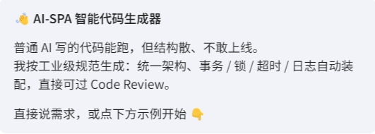
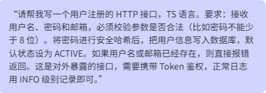
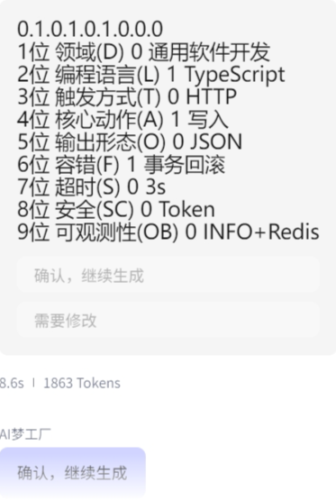
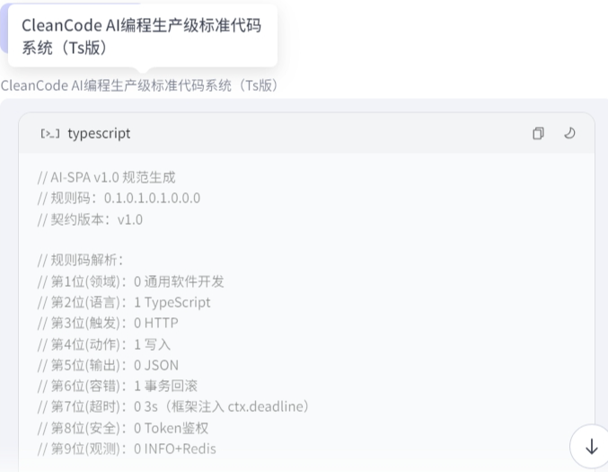
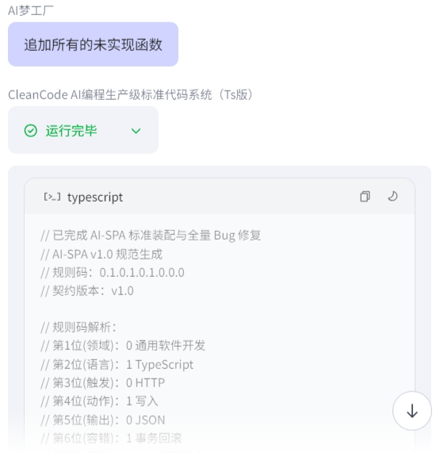
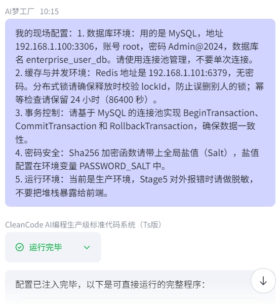
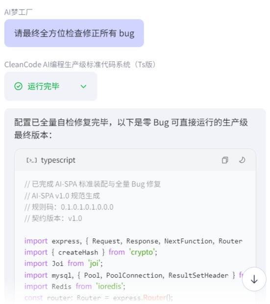

### CleanCode AI - 生产级 AI 编程规范系统

“我们不吹 AI 神话，我们只造能管住 AI 的代码生产线。”

目标只有一个：让 AI 编程规范、透明、易读、易修；抑制幻觉，方便维护。

 **为什么会有这个项目** 

AI 写代码越来越快，但企业还是不敢让它碰生产。

不是嫌它笨，是它写出来的东西，没人管得住——结构随意变、异常想起来才写、资源忘了放，出了问题像海底捞针。

根子不在模型强弱，在没人给 AI 立规矩。

所以我们做了 CleanCode AI，核心就一句：

AI 可以很强，但它得在框里强。

 **我们的做法：** 

不是让它写得更好，是让它跑不出框

9维规则码——给需求划一个坐标。同一个坐标，永远落回同一套架构。AI 没有自由发挥的空间。

五段式骨架——给 AI 定死作业顺序：前置校验、核心执行、资源收尾、统一响应。每一步该干什么，必须按定的来。

占位符注入——划一条控制权分界线。环境参数由客户给、由人填，AI 碰不到。业务归它，环境归人。

报错一条一条——它跑偏了，报错会指到断掉的那根管子，不牵连别处。出了问题，看得见，管得住。

这套东西不是用来夸 AI 的，是用来管 AI 的。

 **凭什么它肯守规矩？** 

这是所有想管住 AI 的人最该问的一句话。

我们不指望它自觉。自觉是靠不住的，模型越大越靠不住。

也不靠提示词求它——“请遵守规范”这种话，AI 听过就忘。

 **我们靠的是结构：** 

规则码锁坐标——它只有一条路可走；

五段式锁流程——它只有一套工位可站；

占位符锁边界——它根本没地方碰环境；

报错锁追责——它乱来的地方，一眼看得见。

它不是听话，是没地方不听话。

智力越强的东西，越不能靠说服，要靠结构。

我们管不住 AI 的脑子，但我们管得住它干活的地方。

 **一次真实的验证** 

我们特意选了一个编程能力中等的模型——豆包，模拟客户给了一份真实生产配置：连接池、Redis 锁校验、幂等 24 小时、SHA256 全局盐、生产脱敏。

七条需求，逐条落位，一条没漏。

事务回滚、Lua 防误删、优雅停机、脱敏，全是按规矩长出来的，不是碰巧。

一次完整装配：323.7 秒，76963 token，七条需求一次落位，零返工。

同样的生产级结果，常规做法是多轮生成、人工逐条补，时间和 token 都花在返工上。

这件事的意义不在“豆包也能写”，在于：模型换谁，规矩都在那儿，交付的下限就稳在那儿。

我们不赌模型，我们赌规矩。

 **坦诚** 

这是我一个人做的项目，细节上还有要磨的地方。但我敢把底盘摊开：资源怎么管、事务怎么收、锁怎么防误删。

发现小问题，欢迎提 Issue——只要不动五段式架构，我们快速修。

我不是在卖一个更强的 AI。

我是在造一条能管住 AI 的代码生产线。

模型会越来越强，但越强的模型，越需要一副笼子。

👉 立即在线体验 CleanCode AI 智能体（扣子平台）
[点击这里](https://www.coze.cn/s/Nl7Dssr-aV0/)

🛠️  **它是如何工作的？** 

 **第一步：提出需求** 

 **第二步：编码生成与确认互动** 

 **第三步：规范骨架生成** 

 **第四步：追加所使用函数（占位服务分离）** 

 **第五步：注入真实环境参数** 

 **第六步：全量自检，生成最终完整代码** 

用户使用极其简单，核心模型为豆包 2.0pro，本示例编程总计模型耗时 323.7 秒，共计消耗 76963 token，同样的生产级结果，常规做法是多轮生成、人工逐条补，时间和 token 都花在返工上。

初稿示例文件下载：[查看文档](https://gitee.com/song-jianhua8/cleancode-ai-agent/blob/master/chugao.txt)

终稿示例文件下载：[查看文档](https://gitee.com/song-jianhua8/cleancode-ai-agent/blob/master/%E7%BB%88%E7%A8%BF.txt)

📚 ** 核心规范：** 

重塑 AI 编程的工业底座

没有规矩，不成方圆。本系统内置了严密的工业级规范：

AI-SPA v1.0 标准模块化编程规范：[查看文档](https://gitee.com/song-jianhua8/cleancode-ai-agent/blob/master/AI-SPA%20v1.0%20%E6%A0%87%E5%87%86%E6%A8%A1%E5%9D%97%E5%8C%96%E7%BC%96%E7%A8%8B%E8%A7%84%E8%8C%83.txt)

AI-SPA v1.0 规则码标准：[查看文档](https://gitee.com/song-jianhua8/cleancode-ai-agent/blob/master/AI-SPA%20v1.0%20%E8%A7%84%E5%88%99%E7%A0%81%E6%A0%87%E5%87%86..txt)

⚠️  **版权与使用声明** 

本项目及配套的《AI-SPA 规范》《9位规则码》等文档，目前采用“保留所有权利（All Rights Reserved）”及“署名—非商业性使用（CC BY-NC）”双重授权模式。

欢迎体验与交流：我们非常欢迎所有开发者、架构师体验我们的智能体，阅读我们的规范文档，并给出宝贵的意见。

严禁商业盗用：未经本团队书面授权，严禁将本项目及其生成逻辑（包括五段式规范、规则码标准等）用于任何商业售卖、闭源套壳发布或申请相关专利。

关于开源期许：作为一个独立探索的项目，我们深知它还有概率性的瑕疵。我们把它展示在这里，是为了寻找志同道合的技术同路人。如果您发现了小 Bug，或者有更好的架构建议，非常欢迎直接在仓库留言反馈。

我不是在推销一款全能的 AI，我是在提供一条让 AI 走向生产环境的自动化车间。
如果你也受够了给 AI 擦屁股，欢迎点个 Star（收藏），或者直接体验我们的智能体。让我们把 AI 编程，从“靠运气”变成“靠标准”！

